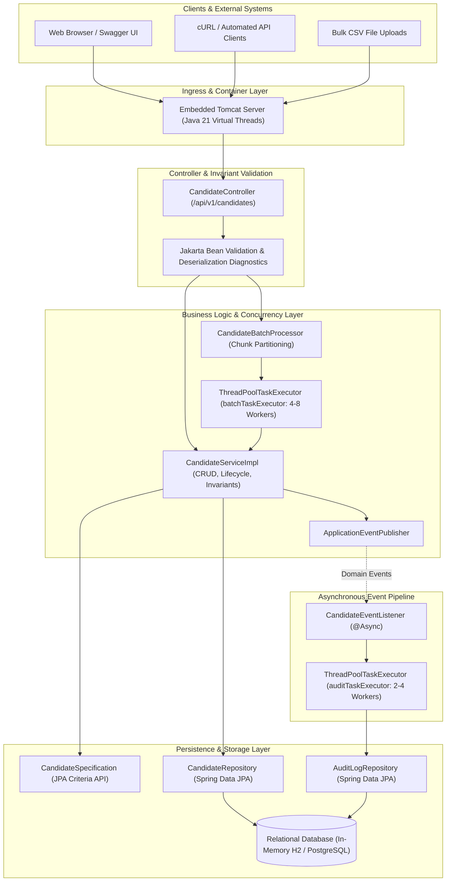
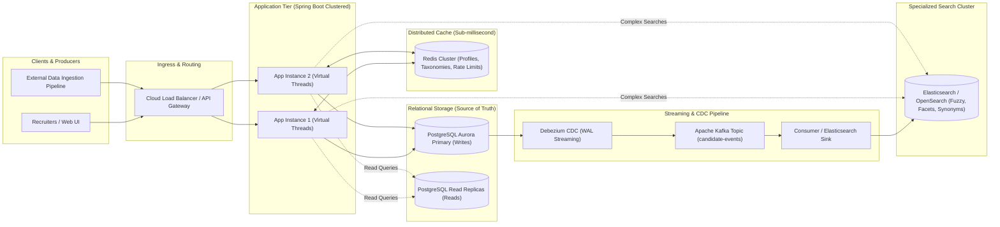

# Technical Design Document: Candidate Management Service

## 1. Executive Summary

This document details the architectural decisions, domain model, concurrency design, and scalability roadmap for the Candidate Management Service (`crm-candidate-management`). The system is engineered to provide candidate lifecycle operations, dynamic multi-criteria search, and asynchronous bulk data ingestion for modern recruitment platforms.

---

## 2. Architecture & Design Principles

### 2.1 High-Level Architecture Diagram



#### Textual Representation
```
[Clients: UI / cURL / CSV]
           │
           ▼
[Tomcat (Java 21 Loom Virtual Threads)]
           │
           ▼
[CandidateController] ──> [Bean Validation & Error Diagnostics]
           │
           ├───> [CandidateServiceImpl] ──> [CandidateRepository] ──> [H2 / PostgreSQL]
           │             │                          │
           │             └───> [Domain Events]      └──> [CandidateSpecification]
           │                          │
           │                          ▼
           │             [CandidateEventListener (@Async)] ──> [AuditLogRepository]
           │
           └───> [CandidateBatchProcessor]
                         │
                         ▼
             [batchTaskExecutor (CompletableFuture)]
             ├── Worker 1 (Chunk 1: 50 items)
             ├── Worker 2 (Chunk 2: 50 items)
             └── Worker N (Chunk N: 50 items)
```

### 2.2 Layered Architecture
The service adheres to clean layered architecture with clear separation of concerns:
- **Web / Controller Layer**: Exposes versioned REST APIs (`/api/v1/candidates`), validates input constraints via Jakarta Bean Validation, and marshals requests/responses.
- **Service Layer**: Encapsulates business logic, enforces email uniqueness invariants, and coordinates transactional workflows.
- **Persistence Layer**: Spring Data JPA abstractions over relational storage with dynamic specification criteria builders.
- **Asynchronous & Event Layer**: Decoupled event publishing (`CandidateCreatedEvent`, `CandidateStatusChangedEvent`) and multi-threaded batch processors.

### 2.3 Domain Model & Data Schema
The primary entity is `Candidate`, representing job applicants:
- **Identity & Contact**: `id` (primary key), `firstName` (mandatory), `lastName` (mandatory), `email` (unique index, mandatory), `phone`, `location` (mandatory).
- **Professional Attributes**: `currentTitle` (mandatory), `yearsOfExperience` (indexed for range queries, bounded between 0 and 80), `expectedSalary`, `skills` (normalized secondary collection, minimum 3 tags required).
- **Lifecycle & Audit**: `status` (indexed enum), `summary`, `createdAt`, `updatedAt`.

The supporting entity `AuditLog` captures state changes and background worker thread details asynchronously:
- `id`, `candidateId`, `eventType`, `description`, `performedBy`, `threadName`, `timestamp`.

Both `Candidate` and `AuditLog` implement `java.io.Serializable` with explicit `serialVersionUID` fields, ensuring readiness for distributed caching (e.g. Redis session/entity caching) and horizontal clustering.

### 2.4 Dynamic Multi-Criteria Search
Dynamic filtering is implemented using Spring Data JPA's Criteria API via `CandidateSpecification`:
- Full-text keyword matching across `firstName`, `lastName`, `email`, `currentTitle`, and `summary` using case-insensitive SQL `LIKE` clauses.
- Range filters on `yearsOfExperience` and `expectedSalary`.
- Skill matching using `INNER JOIN` against the collection table with distinct query projection (`query.distinct(true)`) to prevent Cartesian row duplication.
- Native integration with Spring Data `Pageable` to enforce limit/offset pagination and index-backed sorting, protecting database memory.

---

## 3. Concurrency & Multi-Threading Architecture

Concurrency was introduced to address concrete performance bottlenecks rather than added as superficial complexity:

### 3.1 Concurrency Flow Diagram

```mermaid
flowchart TD
    subgraph RequestHandling["1. Virtual Threads (Project Loom)"]
        Req["Client HTTP Requests (REST / Search)"] --> Loom["Virtual Thread Per Request"]
        Loom --> Carrier["Platform Carrier Thread Yields on I/O (Zero OS Thread Blocking)"]
    end

    subgraph BatchIngestion["2. Partitioned Parallel Batch Ingestion"]
        Input["Bulk Candidates Input (CSV or JSON Payload)"] --> Chunking["Chunk Partitioning (50 records per chunk)"]
        Chunking --> Chunk1["Chunk 1"]
        Chunking --> Chunk2["Chunk 2"]
        Chunking --> ChunkN["Chunk N"]
        
        Chunk1 --> Worker1["Worker Thread 1 (batchTaskExecutor)"]
        Chunk2 --> Worker2["Worker Thread 2 (batchTaskExecutor)"]
        ChunkN --> WorkerN["Worker Thread N (batchTaskExecutor)"]
        
        Worker1 --> CF1["CompletableFuture 1"]
        Worker2 --> CF2["CompletableFuture 2"]
        WorkerN --> CFN["CompletableFuture N"]
        
        CF1 --> AllOf["CompletableFuture.allOf(...)"]
        CF2 --> AllOf
        CFN --> AllOf
        
        AllOf --> Aggregate["Aggregate Results: Total Processed, Succeeded, Failed (Isolated Errors)"]
    end

    subgraph AuditPipeline["3. Asynchronous Event-Driven Audit Pipeline"]
        Event["Candidate Created / Status Changed Event"] --> EventBus["ApplicationEventPublisher"]
        EventBus -. Async .-> Listener["CandidateEventListener (@Async)"]
        Listener --> AuditWorker["auditTaskExecutor Worker Thread"]
        AuditWorker --> AuditLog["AuditLog Persisted (Includes Worker Thread Name)"]
    end
```



### 3.2 Java 21 Project Loom (Virtual Threads)
By configuring `spring.threads.virtual.enabled: true`, the embedded Tomcat container serves each HTTP request on a lightweight virtual thread. When an I/O operation (database query, disk read) blocks, the underlying platform carrier thread is yielded, allowing thousands of concurrent client connections with negligible memory overhead compared to traditional platform thread pools.

### 3.3 Partitioned Parallel Batch Ingestion (`CandidateBatchProcessor`)
Importing thousands of candidates via CSV or JSON is an I/O and CPU intensive task. To maximize throughput:
1. Candidate requests are partitioned into balanced chunks (default 50 records per chunk).
2. Each chunk is dispatched as an independent task via `CompletableFuture.supplyAsync()` to a dedicated `ThreadPoolTaskExecutor` (`batchTaskExecutor`).
3. Chunks execute concurrently on worker threads (`batch-worker-1`, `batch-worker-2`, etc.).
4. Results and per-record errors are aggregated non-blockingly using `CompletableFuture.allOf()`.
5. Failures on individual records (e.g., malformed email, duplicate constraint, or insufficient skills) are isolated so valid candidates in the batch are committed without aborting the entire upload.

### 3.4 Asynchronous Domain Events (`@Async`)
Operations that modify candidate state publish domain events. The event listener `CandidateEventListener` runs asynchronously on a segregated `auditTaskExecutor` thread pool. This ensures:
- Primary CRUD response latency remains minimal.
- Database write locks on candidate tables are committed immediately without waiting for audit logging or notification dispatch.

---

## 4. Error Handling & SonarQube Compliance

### 4.1 Input Validation & Diagnostic Error Handling
1. **Jakarta Bean Validation**: Applied at controller boundaries (`@NotBlank`, `@Email`, `@Size(min=3)`, `@Min(0)`, `@Max(80)`).
2. **Jackson Deserialization Diagnostics**: When an invalid request body is received (e.g., string passed to an integer field, or invalid enum string), `GlobalExceptionHandler` intercepts `InvalidFormatException` and extracts the offending field name, rejected value, and accepted enum constants into `fieldErrors` rather than returning a generic HTTP 400.
3. **Route & Resource Error Handling**: Explicitly handles `NoResourceFoundException` returning HTTP 404 with guidance toward Swagger UI, and `HttpRequestMethodNotSupportedException` returning HTTP 405 with allowed methods.
4. **Uniform RFC 7807 Error Model**: All exceptions return an immutable `ErrorResponse` record containing timestamp, HTTP status, error description, request URI, and field-level validation breakdowns with null fields omitted.

### 4.2 SonarQube & Clean Code Rule Compliance
The application is engineered to pass strict SonarQube Quality Profiles:
1. **Entity & Exception Serialization (`java:S2057`, `java:S1948`, `java:S2055`)**:
   - `Candidate` and `AuditLog` JPA entities implement `java.io.Serializable` with explicit `private static final long serialVersionUID = 1L;` to guarantee safe serialization across distributed caches (Redis) and cluster sessions.
   - All custom exceptions (`BadRequestException`, `DuplicateResourceException`, `ResourceNotFoundException`) declare explicit `serialVersionUID`.
2. **Parameterized Logging (`java:S2629`)**:
   - Every SLF4J logger invocation across all layers utilizes parameterized placeholders (`log.info("...", arg)`), completely avoiding string concatenation performance penalties when debug or info logging is disabled.
3. **No Swallowed Generic Exceptions (`java:S2221`)**:
   - Catch-all blocks (`catch (Exception e)`) have been eliminated from business logic. Specific checked exceptions (such as `IOException`) and domain runtime exceptions are caught, logged with stack traces, or translated into structured client errors.
4. **Thread Safety & Pool Bounding (`java:S2142`)**:
   - Thread pools in `AsyncConfig` specify defined queue capacities and a `ThreadPoolExecutor.CallerRunsPolicy` rejection handler to eliminate Denial-of-Service risks via unbounded queue allocation.
   - Graceful shutdown hooks (`setWaitForTasksToCompleteOnShutdown(true)`) ensure in-flight tasks finish before JVM shutdown.
5. **DTO Immutability via Java 21 Records**:
   - All data transfer objects are implemented as Java 21 Records, ensuring immutability, thread safety, and standard `equals`, `hashCode`, and `toString` implementations without boilerplate.
6. **Sonar Scanner Integration**:
   - The Maven build integrates `sonar-maven-plugin` (v4.0.0.4121) with `sonar.coverage.jacoco.xmlReportPaths` mapped to JaCoCo XML reports for automated CI/CD static analysis:
     ```bash
     mvn sonar:sonar -Dsonar.host.url=http://your-sonarqube-host:9000 -Dsonar.token=your-token
     ```

---

## 5. Automated Testing Architecture (JUnit 5 & JaCoCo)

The application implements a multi-layered testing pyramid ensuring deterministic verification of business logic, HTTP contracts, and data persistence:

### 5.1 Testing Pyramid & Methodologies

```
              ┌──────────────────────────┐
              │   @SpringBootTest (1)    │  Context Wiring & Bootstrap
              ├──────────────────────────┤
              │      @WebMvcTest (2)     │  HTTP Contracts, Validation,
              │                          │  Routing & Status Codes
              ├──────────────────────────┤
              │      @DataJpaTest (1)    │  JPA Criteria API, Pagination,
              │                          │  Indexing & Query Specifications
              ├──────────────────────────┤
              │    Isolated Unit (5)     │  Service Invariants, Batch Loom
              │                          │  Threading, Lifecycle & Mappings
              └──────────────────────────┘
```

1. **Unit Testing (JUnit 5 + Mockito + AssertJ)**:
   - `CandidateServiceTest`: Validates candidate lifecycle transitions, duplicate email detection, transactional event publishing, and CSV stream parsing edge cases.
   - `CandidateBatchProcessorTest`: Tests chunk partitioning, concurrent task dispatching via `CompletableFuture`, partial batch failure isolation, and comprehensive validation rules.
   - `CandidateEventListenerTest`: Verifies asynchronous domain event consumption and audit log generation with worker thread metadata.
   - `GlobalExceptionHandlerTest`: Validates error response formatting across all exception types, Jackson mapping failures, and constraint violations.
   - `EntityAndDtoTest`: Verifies JPA lifecycle hooks (`@PrePersist`, `@PreUpdate`), entity accessors, contract equality (`equals`/`hashCode`), and DTO record transformations.

2. **Web Slice Testing (`@WebMvcTest` + MockMvc)**:
   - `CandidateControllerTest`: Tests RESTful API contracts, JSON request/response serialization, multipart CSV file uploads, query parameter sorting, and validation error responses.
   - `RootControllerTest`: Tests root discovery endpoint (`GET /`) and navigation metadata links.

3. **Data Access Slice Testing (`@DataJpaTest`)**:
   - `CandidateRepositoryTest`: Executes against an in-memory H2 database to verify Spring Data JPA specifications, case-insensitive keyword searches, skill collections inner joins with deduplication (`query.distinct(true)`), and range queries.

4. **Integration Bootstrap Testing (`@SpringBootTest`)**:
   - `CandidateManagementApplicationTest`: Verifies Spring application context bootstrapping, bean wiring, Virtual Threads configuration, and static main method invocation.

### 5.2 JaCoCo Code Coverage & Quality Metrics
- **Automated Tests**: **69 automated tests** (0 failures, 0 errors, 0 skipped).
- **Line Coverage**: **100.0%** across all 25 classes (644 / 644 lines covered, 0 missed lines).
- **Instruction Coverage**: **99.8%** (3,182 / 3,189 instructions covered).
- **Automated Quality Reports**:
  - Interactive HTML report generated on every test run at `target/site/jacoco/index.html`.
  - Machine-readable XML report at `target/site/jacoco/jacoco.xml` for continuous integration and SonarQube ingestion.
- **Execution Command**:
  ```bash
  mvn clean test
  ```

---

## 6. Scalability Evolution Roadmap

To evolve this service to handle millions of candidates and thousands of concurrent recruiters, the following incremental architecture evolution is proposed:

### 6.1 Target Enterprise Architecture Diagram



### 6.2 Storage Layer Evolution
- **Relational Database Migration**: Transition from embedded H2 to managed PostgreSQL (e.g., AWS RDS Aurora PostgreSQL).
- **Primary-Replica Topology**: Route write traffic (CRUD, batch imports) to the primary node and read traffic (candidate searches, profile views) across multiple read replicas via Spring's `AbstractRoutingDataSource`.
- **Table Partitioning**: Partition the `candidates` table by registration year or geographic region to maintain predictable B-Tree index depths.
- **Connection Pooling**: Tune HikariCP connection pool parameters based on server CPU carrier threads and database I/O limits.

### 6.3 Search Engine Offloading (Elasticsearch / OpenSearch)
While JPA Specifications work well for small-to-medium datasets, complex full-text search, fuzzy matching, and multi-facet filtering at scale can saturate relational database CPU.
- Offload candidate searching to an Elasticsearch cluster.
- Implement Change Data Capture (CDC) using Debezium on PostgreSQL write-ahead logs (WAL) streaming into Apache Kafka.
- A consumer microservice indexes candidate documents in real time into Elasticsearch, allowing sub-50ms search latency across millions of records with typo-tolerance and skill synonyms.

### 6.4 Distributed Caching Layer (Redis)
- Cache frequent lookups (candidate profiles by ID, standard taxonomy tables) in Redis with an appropriate Time-To-Live (TTL).
- Use cache-aside pattern with automatic cache invalidation triggered on `CandidateUpdatedEvent`.
- Implement distributed rate limiting (Token Bucket via Redis) to prevent scraping and API abuse.

### 6.5 Distributed Event Streaming & Batch Queuing (Kafka)
- Transition the in-process `CandidateBatchProcessor` to a distributed queue using Apache Kafka.
- Bulk uploads produce messages to a `candidate-import-jobs` topic.
- A cluster of horizontally scaled worker instances consume from partitioned topics, enabling linear ingestion throughput scaling up to tens of thousands of records per second without impacting the API gateway.

### 6.6 Observability & Security
- **Distributed Tracing**: Integrate OpenTelemetry and Micrometer with Prometheus and Grafana for latency tracing and JVM metrics.
- **Security**: Secure API endpoints using OAuth 2.0 / OpenID Connect (Keycloak or Okta) with role-based access control (`ROLE_RECRUITER`, `ROLE_ADMIN`).
