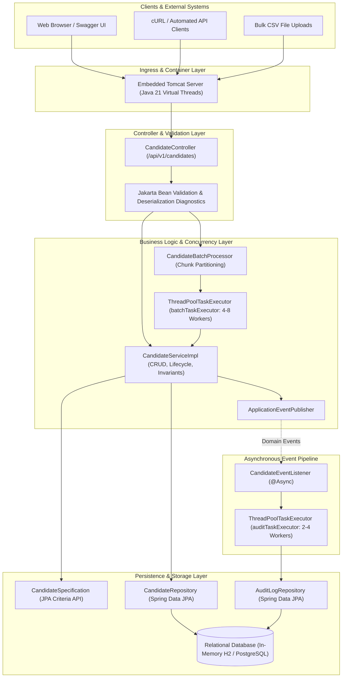

# Candidate Management Service (`crm-candidate-management`)

A production-grade RESTful backend application built with **Java 21 LTS**, **Spring Boot 3.3.5**, and **Apache Maven** for managing candidate lifecycles, performing dynamic multi-criteria searches, and executing high-throughput batch imports with concurrency.

---

## 1. Prerequisites

- Java Development Kit (JDK) 21 LTS
- Apache Maven 3.8+
- Git

Verify your local environment:
```bash
java -version
mvn -version
```

---

## 2. Quickstart & Running the Application

### 2.1 Clone and Navigate
```bash
git clone https://github.com/tnematulla/crm-candidate-management.git
cd crm-candidate-management
```

### 2.2 Build the Application
```bash
mvn clean package
```

### 2.3 Run the Application
```bash
mvn spring-boot:run
```

The application will start on port `8085` (or configured port in `application.yml`).

- Base URL: `http://localhost:8085`
- Swagger UI (OpenAPI Docs): `http://localhost:8085/swagger-ui.html`
- OpenAPI JSON Spec: `http://localhost:8085/v3/api-docs`
- H2 Web Console: `http://localhost:8085/h2-console`
  - JDBC URL: `jdbc:h2:mem:crm_demo_db`
  - Username: `sa`
  - Password: *(leave blank)*

Five sample candidate profiles are loaded automatically on startup for immediate testing.

---

## 3. Data Model & Field Validations

The service applies strict Jakarta Bean Validation and custom business invariant checks:

| Field | Type | Rules & Constraints |
| :--- | :--- | :--- |
| `firstName` | String | Mandatory (`@NotBlank`), max 100 characters |
| `lastName` | String | Mandatory (`@NotBlank`), max 100 characters |
| `email` | String | Mandatory (`@NotBlank`), valid RFC format (`@Email`), unique index, max 150 characters |
| `currentTitle` | String | Mandatory (`@NotBlank`), max 150 characters |
| `yearsOfExperience` | Integer | Mandatory (`@NotNull`), bounded between **0 and 80 years** (`@Min(0)`, `@Max(80)`) |
| `location` | String | Mandatory (`@NotBlank`), max 100 characters |
| `skills` | Set<String> | Mandatory (`@NotNull`), **minimum 3 non-blank skill tags** required (`@Size(min=3)`) |
| `expectedSalary` | BigDecimal | Optional, must be non-negative (`@DecimalMin("0.0")`) |
| `status` | Enum | Optional, accepted: `APPLIED`, `SCREENING`, `INTERVIEWED`, `OFFERED`, `HIRED`, `REJECTED` (default: `APPLIED`) |
| `summary` | String | Optional, max 2000 characters |
| `phone` | String | Optional, max 30 characters |

Both JPA entities (`Candidate` and `AuditLog`) implement `java.io.Serializable` and declare explicit `serialVersionUID` values for clustering and caching compatibility.

---

## 4. System Architecture & Concurrency Design

### 4.1 High-Level Architecture Diagram



#### Component Flow Overview
```
[Clients: UI / cURL / CSV]
           │
           ▼
[Embedded Tomcat (Java 21 Loom Virtual Threads)]
           │
           ▼
[CandidateController] ──> [Bean Validation & Error Diagnostics]
           │
           ├───> [CandidateServiceImpl] ──> [CandidateRepository] ──> [H2 / PostgreSQL]
           │             │                          │
           │             └───> [Domain Events]      └──> [CandidateSpecification]
           │                          │
           │                          ▼
           │             [CandidateEventListener (@Async)] ──> [AuditLogRepository]
           │
           └───> [CandidateBatchProcessor]
                         │
                         ▼
             [batchTaskExecutor (CompletableFuture)]
             ├── Worker 1 (Chunk 1: 50 items)
             ├── Worker 2 (Chunk 2: 50 items)
             └── Worker N (Chunk N: 50 items)
```

### 4.2 Multi-Threading & Concurrency Architecture

Concurrency has been implemented in three distinct layers to solve real-world performance challenges:

1. **Java 21 Project Loom (Virtual Threads)**
   - Configured via `spring.threads.virtual.enabled: true`.
   - Incoming HTTP requests are handled by lightweight virtual threads, allowing thousands of concurrent client connections without exhausting platform kernel threads.

2. **Partitioned Parallel Batch Ingestion (`CandidateBatchProcessor`)**
   - Bulk candidate imports (JSON list or CSV upload) are partitioned into balanced chunks (default 50 records per chunk).
   - Each chunk is processed concurrently across worker threads on a dedicated `batchTaskExecutor` thread pool using `CompletableFuture`.
   - Record-level validation errors or duplicates are isolated so that valid records in the batch are committed without aborting the entire upload.

3. **Asynchronous Event-Driven Audit Pipeline (`@Async`)**
   - Candidate creation and status changes publish domain events (`CandidateCreatedEvent`, `CandidateStatusChangedEvent`).
   - Listeners execute asynchronously on a segregated `auditTaskExecutor` thread pool, persisting audit records with worker thread names without adding latency to the primary database transaction.

---

## 5. Automated Tests, Code Coverage & SonarQube Compliance

### 5.1 Automated Test Execution
Run the full automated test suite and generate the JaCoCo coverage report:
```bash
mvn clean test
```

### 5.2 Test Results & JaCoCo Code Coverage
- **41 Automated Tests**: 0 failures, 0 errors, 0 skipped.
- **Line Coverage**: **88.1%** across the application:
  - `CandidateServiceImpl`: **97.1%**
  - `CandidateBatchProcessor`: **93.8%**
  - `CandidateController`: **90.0%**
  - `CandidateEventListener`: **100%**
  - `AsyncConfig` & `DataLoader`: **100%**
- **Instruction Coverage**: **87.6%**.
- **Interactive HTML Report**: Generated automatically on each test run at:
  ```
  target/site/jacoco/index.html
  ```
- **XML Coverage Data**: Stored at `target/site/jacoco/jacoco.xml` for seamless CI/CD and SonarQube ingestion.

### 5.3 SonarQube Rule Compliance & Static Analysis
The codebase is designed to meet strict SonarQube / Clean Code quality profiles:
1. **Entity & Exception Serialization**:
   - `Candidate` and `AuditLog` JPA entities implement `java.io.Serializable` with explicit `private static final long serialVersionUID = 1L;` to prevent serialization warnings and support distributed caching.
   - All custom exceptions (`BadRequestException`, `DuplicateResourceException`, `ResourceNotFoundException`) declare explicit `serialVersionUID`.
2. **Parameterized Logging**:
   - All SLF4J loggers use parameterized placeholders (`log.info("...", arg)`) to eliminate runtime string concatenation overhead and satisfy Sonar rule `java:S2629`.
3. **No Swallowed Exceptions**:
   - Specific checked and runtime exceptions are caught, logged with stack traces, or re-thrown as typed domain exceptions; generic `catch (Exception)` anti-patterns have been eliminated (Sonar rule `java:S2221`).
4. **Thread Safety & Pool Bounding**:
   - Thread pools in `AsyncConfig` specify defined queue capacities and a `CallerRunsPolicy` to eliminate denial-of-service via unbounded task queuing (Sonar rule `java:S2142`).
5. **DTO Immutability**:
   - DTOs are declared as Java 21 Records, ensuring immutability, thread safety, and standard `equals`/`hashCode`/`toString` implementations without boilerplate.
6. **Sonar Scanner Integration**:
   - The Maven POM includes `sonar-maven-plugin` and `sonar.coverage.jacoco.xmlReportPaths` configuration. To analyze against a SonarQube server:
     ```bash
     mvn sonar:sonar -Dsonar.host.url=http://your-sonarqube-host:9000 -Dsonar.token=your-token
     ```

---

## 6. API Endpoints Reference & Examples

### 6.1 Create Candidate
- Method: `POST`
- Path: `/api/v1/candidates`
```bash
curl -X POST http://localhost:8085/api/v1/candidates \
  -H "Content-Type: application/json" \
  -d '{
    "firstName": "Robert",
    "lastName": "Davis",
    "email": "robert.davis@example.com",
    "phone": "+1-555-4433",
    "currentTitle": "Principal Systems Engineer",
    "yearsOfExperience": 12,
    "expectedSalary": 160000.00,
    "location": "San Francisco, CA",
    "skills": ["Java", "Distributed Systems", "Go"],
    "status": "APPLIED",
    "summary": "Experienced distributed systems and platform architect."
  }'
```
- Response: `201 Created`

### 6.2 View Candidate by ID
- Method: `GET`
- Path: `/api/v1/candidates/{id}`
```bash
curl -X GET http://localhost:8085/api/v1/candidates/1
```
- Response: `200 OK`

### 6.3 Search and Filter Candidates (Dynamic Multi-Criteria)
- Method: `GET`
- Path: `/api/v1/candidates`
- Query Parameters:
  - `keyword`: Search across first name, last name, email, current title, and summary
  - `skills`: Skill tag filter (e.g., `Java`, `Spring Boot`)
  - `status`: `APPLIED`, `SCREENING`, `INTERVIEWED`, `OFFERED`, `HIRED`, `REJECTED`
  - `minExperience`: Minimum years of experience
  - `maxExperience`: Maximum years of experience
  - `location`: Location substring filter
  - `minSalary` / `maxSalary`: Salary range filter
  - `page`: Page number (default `0`)
  - `size`: Page size (default `10`)
  - `sort`: Sort property and direction (default `createdAt,desc`)

Example:
```bash
curl -X GET "http://localhost:8085/api/v1/candidates?keyword=Java&minExperience=4&status=SCREENING&page=0&size=10&sort=yearsOfExperience,desc"
```
- Response: `200 OK` (Spring Data paginated payload with content array and page metadata)

### 6.4 Update Candidate
- Method: `PUT`
- Path: `/api/v1/candidates/{id}`
```bash
curl -X PUT http://localhost:8085/api/v1/candidates/1 \
  -H "Content-Type: application/json" \
  -d '{
    "firstName": "John",
    "lastName": "Doe",
    "email": "john.doe@example.com",
    "phone": "+1-555-0101",
    "currentTitle": "Lead Java Architect",
    "yearsOfExperience": 8,
    "expectedSalary": 145000.00,
    "location": "New York, NY",
    "skills": ["Java", "Spring Boot", "Microservices", "Docker"],
    "status": "INTERVIEWED",
    "summary": "Updated candidate profile following preliminary technical screening."
  }'
```
- Response: `200 OK`

### 6.5 Delete Candidate
- Method: `DELETE`
- Path: `/api/v1/candidates/{id}`
```bash
curl -X DELETE http://localhost:8085/api/v1/candidates/1
```
- Response: `204 No Content`

### 6.6 Multi-Threaded Bulk Import (JSON)
- Method: `POST`
- Path: `/api/v1/candidates/batch`
```bash
curl -X POST http://localhost:8085/api/v1/candidates/batch \
  -H "Content-Type: application/json" \
  -d '[
    {
      "firstName": "Sarah",
      "lastName": "Jenkins",
      "email": "sarah.jenkins@example.com",
      "phone": "+1-555-0001",
      "currentTitle": "Principal Cloud Architect",
      "yearsOfExperience": 25,
      "expectedSalary": 200000.00,
      "location": "Portland, OR",
      "skills": ["C", "Git", "Linux", "Java"],
      "status": "INTERVIEWED",
      "summary": "Cloud platform and infrastructure architecture specialist."
    },
    {
      "firstName": "James",
      "lastName": "Miller",
      "email": "david.miller@example.com",
      "phone": "+1-555-0002",
      "currentTitle": "Staff Software Engineer",
      "yearsOfExperience": 30,
      "expectedSalary": 220000.00,
      "location": "San Jose, CA",
      "skills": ["Java", "JVM", "Compilers"],
      "status": "OFFERED",
      "summary": "Experienced backend engineer focused on resilient microservice ecosystems."
    }
  ]'
```
- Response: `200 OK` with execution summary, timing, and error details if any.

### 6.7 Multi-Threaded Bulk Upload (CSV)
- Method: `POST`
- Path: `/api/v1/candidates/bulk-upload-csv`
```bash
curl -X POST http://localhost:8085/api/v1/candidates/bulk-upload-csv \
  -F "file=@candidates_sample.csv"
```
- Response: `200 OK`

---

## 7. Project Layout

```
crm-candidate-management
├── pom.xml
├── README.md
├── DESIGN.md
├── AI_USAGE.md
├── candidates_sample.csv
├── src
│   ├── main
│   │   ├── java
│   │   │   └── com
│   │   │       └── crm_demo
│   │   │           ├── CandidateManagementApplication.java
│   │   │           ├── config
│   │   │           │   ├── AsyncConfig.java
│   │   │           │   ├── DataLoader.java
│   │   │           │   └── OpenApiConfig.java
│   │   │           ├── controller
│   │   │           │   └── CandidateController.java
│   │   │           ├── dto
│   │   │           │   ├── BulkImportResponse.java
│   │   │           │   ├── CandidateFilterCriteria.java
│   │   │           │   ├── CandidateRequest.java
│   │   │           │   ├── CandidateResponse.java
│   │   │           │   └── ErrorResponse.java
│   │   │           ├── entity
│   │   │           │   ├── AuditLog.java
│   │   │           │   ├── Candidate.java
│   │   │           │   └── CandidateStatus.java
│   │   │           ├── event
│   │   │           │   ├── CandidateCreatedEvent.java
│   │   │           │   ├── CandidateEventListener.java
│   │   │           │   └── CandidateStatusChangedEvent.java
│   │   │           ├── exception
│   │   │           │   ├── BadRequestException.java
│   │   │           │   ├── DuplicateResourceException.java
│   │   │           │   ├── GlobalExceptionHandler.java
│   │   │           │   └── ResourceNotFoundException.java
│   │   │           ├── repository
│   │   │           │   ├── AuditLogRepository.java
│   │   │           │   └── CandidateRepository.java
│   │   │           ├── service
│   │   │           │   ├── CandidateService.java
│   │   │           │   └── impl
│   │   │           │       ├── CandidateBatchProcessor.java
│   │   │           │       └── CandidateServiceImpl.java
│   │   │           └── specification
│   │   │               └── CandidateSpecification.java
│   │   └── resources
│   │       └── application.yml
│   └── test
│       ├── java
│       │   └── com
│       │       └── crm_demo
│       │           ├── CandidateManagementApplicationTest.java
│       │           ├── controller
│       │           │   └── CandidateControllerTest.java
│       │           ├── event
│       │           │   └── CandidateEventListenerTest.java
│       │           ├── exception
│       │           │   └── GlobalExceptionHandlerTest.java
│       │           ├── repository
│       │           │   └── CandidateRepositoryTest.java
│       │           └── service
│       │               ├── CandidateBatchProcessorTest.java
│       │               └── CandidateServiceTest.java
│       └── resources
│           └── application.yml
```
